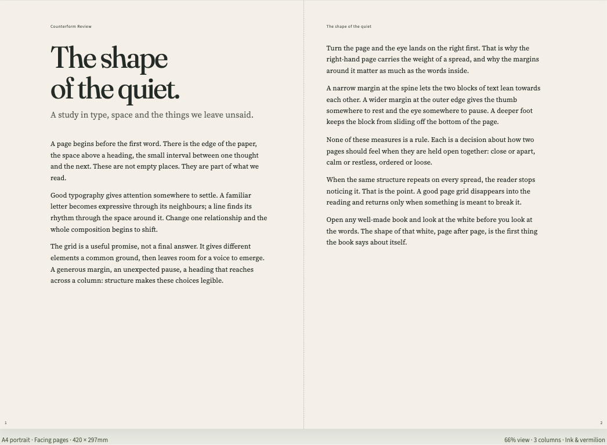
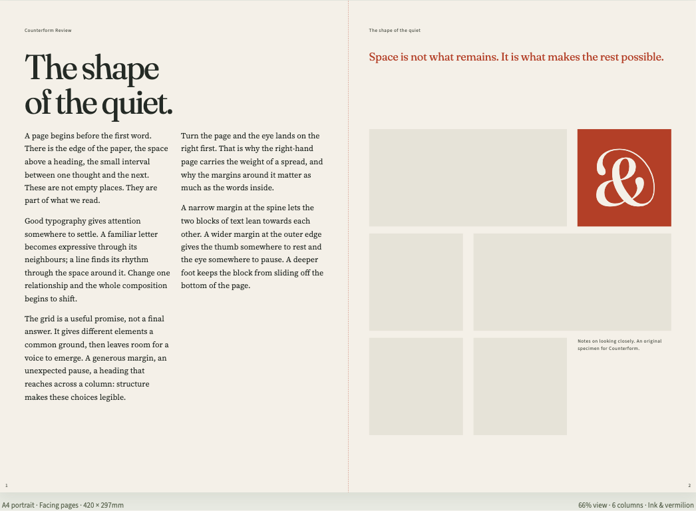
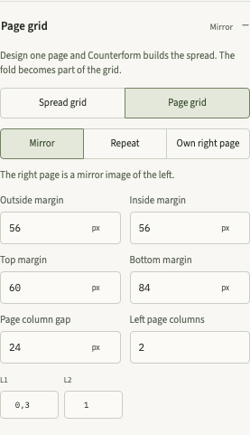
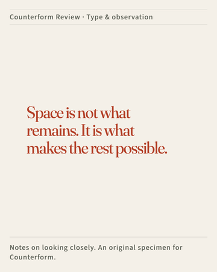
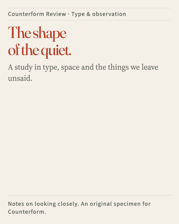
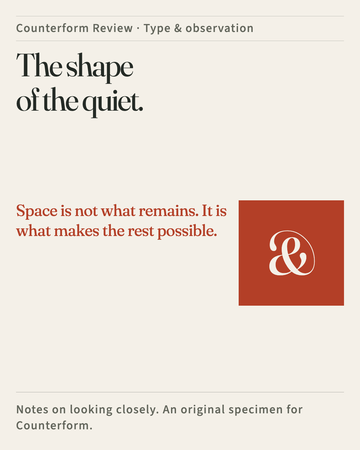

# Counterform

Counterform is a workbench for type, space and colour. Choose a font pairing, shape a grid, set real copy, and see the result as an editorial page, an interface screen or a poster. Then export the system for a website, a print document, a social post or another design agent.

It runs on your own computer. There is no account, no online service and no tracking: a small local server runs on your machine while you use it, and fonts you add stay in your browser.



## What you can do with it

- **Compose with real type.** Twelve open font families are bundled with eight explained pairings, and you can add your own font files. Three specimens (editorial, interface, poster) and six grid recipes let you judge type in a composition rather than in a list.
- **Shape the grid.** Weighted columns and rows, independent margins, spans, responsive overrides for medium and narrow widths, and rhythm and typesetting options. A row can be set to fit its content.
- **Web, print and social from one renderer.**
  - Web: a responsive canvas at wide, medium and narrow widths.
  - Print: A5, A4, A3 and Letter, portrait or landscape, single page or facing pages. Facing pages can use one grid across the spread, or a **page grid**: describe one page and Counterform builds the spread as a mirror, a repeat, or with the right page's own columns. Five facing starters use it: Book page, Margin notes, Spine channel, Two grids, one horizon, and Bridge band.
  - Social: square, portrait, story and landscape formats with Statement, Announcement and Editorial card starters, sized so the text is still readable when the image is seen on a phone.
- **Export.** A ZIP package (`settings.json`, `tokens.css`, `specimen.html` and an agent-readable `DESIGN.md`), editable live-text SVG for Illustrator, a browser PDF proof, IDML for InDesign (one page or one facing spread) and PNG for social formats.
- **Compare and keep versions.** Pin version A while you adjust B and see the exact differences, save named snapshots, and undo a Reset.

| Two grids, one horizon | Page grid controls |
| --- | --- |
|  |  |

| Statement | Announcement | Editorial card |
| --- | --- | --- |
|  |  |  |

## Run it on your computer

You need [Node.js](https://nodejs.org/) 22.12 or a later 22 release, or Node 24 or newer (Node 23 is not supported), plus Git and a desktop browser. Counterform is tested in Chromium (Chrome, Edge) and WebKit (Safari); Firefox is not tested.

Download it and install its tools. The first install needs an internet connection; after that Counterform works offline.

```sh
git clone https://github.com/heydavidf/counterform.git
cd counterform
npm ci
```

npm 11 may warn that `min-release-age` is an unknown project config. That is harmless: the setting, which only installs package versions published at least three days ago, takes effect from npm 12.

Start it:

```sh
npm run dev
```

Open **http://127.0.0.1:4318** in your browser. Keep using that exact address: your saved work and added fonts belong to it. Press Ctrl+C in the terminal to stop Counterform.

If `npm run dev` says the port is already in use, another program is using port 4318. Stop that program and run it again, or start Counterform on another port and open that address instead (here http://127.0.0.1:4400):

```sh
npx vite --host 127.0.0.1 --port 4400 --strictPort
```

Saved work and added fonts belong to each address separately, so keep using the one you choose.

### Your first study

1. In **Type**, pick a font pairing. Select Display, Reading or Supporting to tune that role.
2. Try **Editorial**, **Interface** or **Poster**. Your text stays the same when you switch.
3. Use **Grid** for margins, columns, gutters and overlays, and **Colour** to choose or edit a palette.
4. Replace the sample text in **Content**.
5. Choose **Print**, then **Apply Book page**. Open **Grid**, find **Page grid**, change the inside margin, or switch Mirror to Repeat.
6. Choose **Export system** to see what each download contains, then download a ZIP, an SVG or an IDML.

On a phone-sized window, the inspector button beside the study name jumps to the controls, and **Back to specimen** returns to the composition.

## Ask your agent

To have a coding agent set it up for you, copy this into it:

```text
Set up Counterform from https://github.com/heydavidf/counterform on this computer.
Follow the "Run it on your computer" section of its README exactly, start the app,
and tell me the address to open. Do not change any code or settings.
```

To have an agent change Counterform, point it at [AGENTS.md](AGENTS.md) first. It maps the code and lists the checks a change must pass.

## Your fonts and saved work

Under **Type → Your font files**, add WOFF2, WOFF, TTF or OTF files up to 20 MB each. Give the file's real weight and style first; for a variable weight font, use a range such as `100 900`. The font files stay in this browser's storage and are never uploaded.

Current work saves automatically; snapshots are separate checkpoints. **Reset current study** returns to the starting settings and keeps one **Undo reset**. Browser storage can be cleared, so an exported package is the durable backup: import a ZIP or `settings.json` to move a study to another browser.

Your own font files are left out of ZIP and SVG downloads by default. To include them in one download, choose **Include selected private font files** and confirm that the font's licence allows it. A browser PDF can embed a selected font, so printing asks for the same confirmation. IDML names fonts but contains no font files. Bundled open fonts travel with their licences.

## What the exports are, and are not

`specimen.html` and `tokens.css` use the same renderer as the workbench, and `settings.json` reopens the editable study. `DESIGN.md` records the type roles, sizes, grid, palette contrast, responsive behaviour and font dependencies for another designer or agent.

Print output is a proof, not press production. The browser PDF prints a facing spread as one double-width sheet; there is no pagination, bleed or imposition, and long text does not flow onto further pages. IDML rebuilds editable text frames, paragraph styles and colours from the visible page; the CSS grid is not preserved exactly, and variable font axes may need adjusting in InDesign. Reading text close to the fold of a facing spread gets a warning. With a page grid both pages share their rows. Social starters were tested with English and Swedish sample copy; other copy lengths get the app's fit warnings.

## Development

```sh
npm run build
npm test
npx playwright install chromium webkit
npx playwright test
```

`npm run build` type-checks and builds. `npm test` runs the unit tests. The browser tests start Counterform on port 4318 themselves, or reuse it if it is already running, and use isolated browser profiles, never your own. If a different program is using port 4318, stop it first, or the tests will talk to that program. Screenshots and downloads from the tests go to `test-results/`, which Git ignores. `npm run test:zoom` checks real browser zoom in a temporary Chromium profile; start Counterform with `npm run dev` in another terminal first.

[AGENTS.md](AGENTS.md) explains where things live and the rules for changes. [design/DESIGN.md](design/DESIGN.md) is the interface's design system. Changes are listed in [CHANGELOG.md](CHANGELOG.md).

## Licence

Counterform's code is released under the [MIT licence](LICENSE).

The bundled fonts are licensed separately under the SIL Open Font License 1.1. Each font's licence text sits beside it in `public/fonts/`, and `public/fonts/manifest.json` records each font file's download source, date, size and SHA-256 hash. Exports that include a bundled font include its licence.

## Contributing and security

Issues and small pull requests are welcome; see [CONTRIBUTING.md](CONTRIBUTING.md). Please report security problems privately as described in [SECURITY.md](SECURITY.md).
